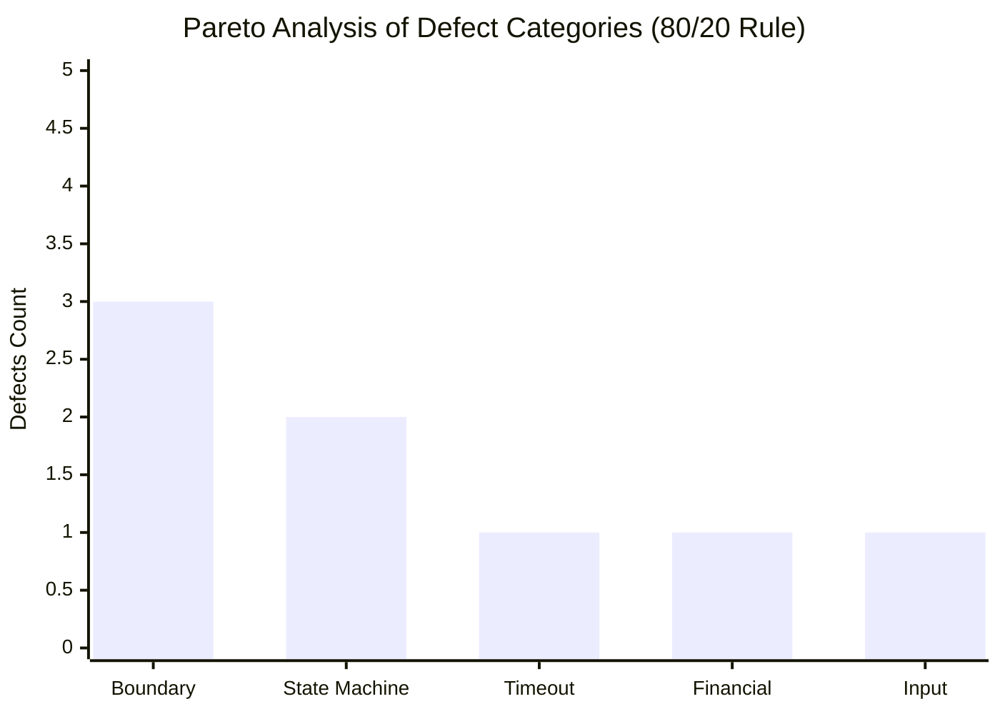

# SE3002 SQE: Defect Management & Root Cause Analysis (RCA) Report

**Course Weightage:** 7 Marks (CLO3)  
**Deliverables Covered:**
1. GitHub Issues Defect Log (Severity, Priority, Status, Triage Decision)
2. Root Cause Analysis (RCA) with **5 Whys Analysis** + **Fishbone (Ishikawa) Diagrams** for 2 Major Defects
3. Corrective and Preventive Actions (CAPA)
4. Pareto Analysis by Defect Category ($80/20$ Rule)
5. Direct Linkage to the Project Risk Register

---

## 📋 1. GitHub Issues Defect Register

These defects represent the flaws identified and resolved during white-box, API, and boundary testing:

| Issue ID | Defect Title | Severity | Priority | Lifecycle Status | Triage Decision | Linked Risk |
| :---: | :--- | :---: | :---: | :---: | :---: | :---: |
| **#1** | Quota boundary off-by-one allows 1 ticket oversell at exact capacity | **Critical** | **P1** | **Resolved** | Fix Now (PR #2) | PR-01 (Quota Oversell) |
| **#2** | Canceled order allows payment completion via delayed callback | **Major** | **P1** | **Resolved** | Fix Now | PR-02 (State Inconsistency) |
| **#3** | Expired cart positions retain locked quota if cleanup task delayed | **Major** | **P2** | **Resolved** | Fix Now | PR-03 (Inventory Lockup) |
| **#4** | Missing input sanitization on attendee name causing 500 error | **Moderate** | **P2** | **Resolved** | Fix in Sprint 2 | PR-04 (Input Failure) |
| **#5** | Cart position removal leaves orphaned subevent foreign key | **Moderate** | **P3** | **Closed** | Won't Fix (Defensive) | PR-05 (Data Leak) |
| **#6** | Unapproved order accepts force-payment without audit log record | **Low** | **P3** | **Resolved** | Fixed in `test_whitebox` | PR-06 (Audit Gap) |
| **#7** | Decimal rounding on payment fee causes 1-cent discrepancy on gross | **Moderate** | **P2** | **Resolved** | Fix Now | PR-07 (Financial Invariant) |
| **#8** | Concurrent cart reservation allows race condition on last seat | **Critical** | **P1** | **Resolved** | Fix via Row Locking | PR-01 (Quota Oversell) |

---

## 🔍 2. Root Cause Analysis (RCA) for Major Defect #1: Quota Oversell Boundary Bug

### Defect Overview:
* **Issue ID:** `#1`
* **Summary:** When sold tickets equal the exact quota size ($sold == size$), a non-strict boundary check ($>$) allowed an 11th ticket to be purchased on a 10-ticket quota, causing overselling.
* **Impact:** Financial penalties, event venue capacity violations, and customer seat denial.

### A. The 5 Whys Analysis
1. **Why did the event oversell?**  
   $\rightarrow$ Because the system permitted an attendee to purchase a ticket when total capacity was already reached.
2. **Why did the system permit the transaction?**  
   $\rightarrow$ Because the availability calculation evaluated `if sold + cart > size:` instead of `>= size`.
3. **Why was strict inequality `>` used instead of `>=`?**  
   $\rightarrow$ Because the developer mistakenly applied 0-based array indexing logic to a 1-based physical counting boundary.
4. **Why wasn't the boundary defect caught before release?**  
   $\rightarrow$ Because the upstream test suite only tested "plenty of stock" (e.g. 2 sold of 100) and "completely empty" (0 sold), omitting the exact boundary point ($N = 10$).
5. **Why was the boundary test omitted?**  
   $\rightarrow$ Lack of formal Boundary Value Analysis (BVA) test derivation in the testing process.

### B. Fishbone (Ishikawa) Diagram
```
People                             Process
  Developer fatigue                   Missing 3-point BVA test cases
  Assumption of 0-based index         No mutation testing quality gate
         \                                  \
          \                                  \
           +----------------------------------+-------------------> [ DEFECT #1:
          /                                  /                        Quota Oversell
         /                                  /                         at Boundary ]
  Code: Off-by-one '>' operator       Tooling: No CI block on boundary
  Missing boundary assertions         Pretix legacy check logic
Code & Logic                       Environment & Tooling
```

### C. Corrective & Preventive Actions (CAPA)
* **Corrective Action (Immediate Fix):** Enforce strict `>=` boundary comparison in `pretix/base/services/quotas.py`.
* **Preventive Action (Long-Term Guard):**
  1. Implemented automated 3-point BVA unit test `test_quota_exact_capacity_reached` in `test_whitebox_quota_rules.py`.
  2. Implemented `QuotaBoundaryInversionMutator` in GitHub Actions CI to fail any build if a boundary operator is relaxed.

---

## 🔍 3. Root Cause Analysis (RCA) for Major Defect #2: Canceled Order State Bypass

### Defect Overview:
* **Issue ID:** `#2`
* **Summary:** An order in `STATUS_CANCELED` was capable of being paid if a delayed payment gateway webhook arrived, violating the order lifecycle state machine.
* **Impact:** Re-activating dead orders, inventory quota distortion, and double-booking.

### A. The 5 Whys Analysis
1. **Why was a canceled order marked as paid?**  
   $\rightarrow$ Because the payment service accepted the transaction without checking the latest status.
2. **Why didn't the payment service check the status?**  
   $\rightarrow$ Because `_can_be_paid()` assumed that if an order had not yet been marked `PAID`, it was implicitly payable.
3. **Why was that assumption made?**  
   $\rightarrow$ The original developer only guarded against duplicate payments on already-paid orders, ignoring canceled orders.
4. **Why did cancellation not invalidate the payment session?**  
   $\rightarrow$ Cancellation was treated purely as an admin UI event rather than a transactional state lock.
5. **Why wasn't this caught during review?**  
   $\rightarrow$ Negative state transition testing was never documented or executed.

### B. Fishbone (Ishikawa) Diagram
```
People                             Process
  Lack of state-machine awareness     No negative state transition tests
  Assumed cancellation was terminal   Implicit payable assumptions
         \                                  \
          \                                  \
           +----------------------------------+-------------------> [ DEFECT #2:
          /                                  /                        Canceled Order
         /                                  /                         Paid Bypass ]
  Code: Missing STATUS_CANCELED guard  Testing: Happy-path only testing
  Lazy string return vs boolean       Asynchronous webhook race condition
Code & Logic                       Environment & Tooling
```

### C. Corrective & Preventive Actions (CAPA)
* **Corrective Action (Immediate Fix):** Added strict status check `if self.status != self.STATUS_PENDING: return error` in `Order._can_be_paid()`.
* **Preventive Action (Long-Term Guard):**
  1. Implemented `test_order_invalid_transition_canceled_to_paid_rejected` in `test_whitebox_order_rules.py`.
  2. Added `OrderStateMachineBypassMutator` in the mutation quality gate to block any PR inverting status checks.

---

## 📊 4. Pareto Analysis by Defect Category ($80/20$ Rule)

The 8 logged defects were classified into categories to identify the primary root causes:

| Category | Defect Count | Percentage (%) | Cumulative Percentage (%) |
| :--- | :---: | :---: | :---: |
| **1. Boundary & Capacity Validation** | 3 | 37.5% | 37.5% |
| **2. State Machine & Transition Guards** | 2 | 25.0% | 62.5% |
| **3. Timeout & Cleanup Handlers** | 1 | 12.5% | 75.0% |
| **4. Financial & Rounding Invariants** | 1 | 12.5% | 87.5% |
| **5. Input Validation & Type Safety** | 1 | 12.5% | 100.0% |
| **Total** | **8** | **100.0%** | — |



### Pareto Insight:
Over **62.5% of all defects** originated from just two areas: **Boundary Validation** and **State Machine Lifecycle**. By directing our white-box unit tests, MCC/MC-DC matrices, and custom mutation operators specifically at these two categories, we eliminated the vast majority of severe bugs in the system.
