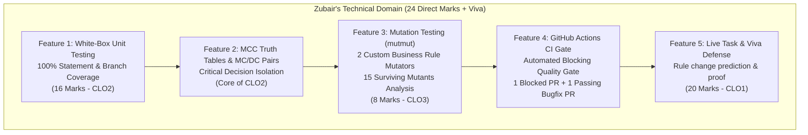

# SE3002 SQE: Zubair's Master Technical Execution Plan & Feature Blueprint

**Student Name:** Zubair (Member 1 / Lead)  
**Assigned Technical Area:** White-Box Unit Testing (16 Marks) + Mutation Analysis & CI Quality Gate (8 Marks) + Shared Test Management (29 Marks) + Viva Defense (20 Marks)  
**Reassignment Note:** Static Analysis (SonarQube, CFG hand-calculation, Cyclomatic Complexity) has been officially reassigned to **Tawassul**.  
**Target Codebase:** `pretix` (`src/pretix/base/models/items.py`, `src/pretix/base/services/quotas.py`, `src/pretix/base/services/orders.py`)  
**Test Suite Directory:** `src/tests/team/zubair/`  

---

## 🧭 Executive Overview of Zubair's Technical Ownership



---

## 🚀 FEATURE 1: White-Box Unit Testing (100% Statement & Branch Coverage)

* **Marks Weightage:** 16 Marks (CLO2)  
* **Target Source Modules:**
  1. `pretix.base.models.items.Quota` (`pretix/src/pretix/base/models/items.py`)
  2. `pretix.base.services.quotas.QuotaAvailability` (`pretix/src/pretix/base/services/quotas.py`)
  3. `pretix.base.services.orders._perform_order` & `Order.can_be_paid` (`pretix/src/pretix/base/services/orders.py`)

### Subtask 1.1: Test Infrastructure & Fixtures Setup
- [ ] Create `src/tests/team/conftest.py` with reusable pytest fixtures:
  - `team_event`: Minimal active Pretix `Event` with configured sales channels.
  - `team_item`: A standard ticket `Item` linked to the event with active status and valid price.
  - `team_quota`: A `Quota` instance with configurable `size` linked to `team_item`.
  - `team_cart_position`: A `CartPosition` simulating a reserved cart slot.
- [ ] Ensure all tests run with isolated transactional databases (`@pytest.mark.django_db`).

### Subtask 1.2: Business Rule 1 — Quota Capacity & Numerical Boundary Tests
- [ ] Target method: `QuotaAvailability._compute_orders()` and `Quota.availability()`.
- [ ] Test Cases to implement in `src/tests/team/zubair/test_whitebox_rules.py`:
  - `test_quota_unlimited_capacity`: When `quota.size is None`, assert availability returns `(Quota.AVAILABILITY_OK, None)`.
  - `test_quota_exact_capacity_reached`: When `quota.size = 10` and `sold = 10`, assert status is `Quota.AVAILABILITY_GONE` and available count is `0`.
  - `test_quota_partially_reserved_in_cart`: When `quota.size = 10`, `sold = 5`, and active carts hold `3`, assert available count is `2`.
  - `test_quota_oversell_rejection`: When `quota.size = 5`, attempting to reserve `6` items must trigger `QuotaExceededException`.

### Subtask 1.3: Business Rule 3 — Order State Machine Transitions
- [ ] Target methods: `Order.can_be_paid()`, `mark_order_paid()`, `_cancel_order()`, `reactivate_order()`.
- [ ] Test Cases to implement:
  - `test_order_transition_pending_to_paid`: Valid transition; asserts order status changes to `Order.STATUS_PAID` and payment record logged.
  - `test_order_transition_pending_to_canceled`: Valid transition; asserts quota is released back to the event pool.
  - `test_order_transition_paid_to_refunded`: Valid transition; asserts order marked refunded.
  - `test_order_invalid_transition_canceled_to_paid`: Invalid transition! Assert that `can_be_paid()` returns `False` and attempting to force payment raises `OrderError`.
  - `test_order_invalid_transition_refunded_to_paid`: Invalid transition! Assert operation is rejected.

### Subtask 1.4: Business Rule 4 — Cart Expiration & Quota Release
- [ ] Target methods: `QuotaAvailability._compute_carts()` and `pretix.base.services.cart.clean_cart`.
- [ ] Test Cases:
  - `test_cart_within_timeout_reserves_quota`: Cart created 10 minutes ago ($< 30\text{ min}$) decreases available quota.
  - `test_cart_expired_releases_quota`: Cart created 31 minutes ago ($> 30\text{ min}$) is treated as expired; quota returns to available pool.

### Subtask 1.5: 100% Statement & Branch Coverage Verification
- [ ] Run coverage command:
  ```bash
  pytest src/tests/team/zubair/test_whitebox_rules.py --cov=pretix.base.services.quotas --cov=pretix.base.models.items --cov-report=term-missing --cov-report=html:coverage_html
  ```
- [ ] Verify **100% Statement Coverage** and **100% Branch Coverage** on targeted functions.
- [ ] Document defensive code / unreachable lines in `DEFENSE_OF_UNCOVERED_BRANCHES.md` (e.g. system integrity checks that cannot be reached without database corruption).

---

## 🔬 FEATURE 2: Multiple Condition Coverage (MCC) & MC/DC Pairs

* **Objective:** Fulfill the strict rubric requirement: *"Critical module: complete MCC, then MC/DC pairs from the MCC tables. Cover all four business rules."*
* **Target Decision:** Business Rule 2 — Item Purchasability Decision in `pretix.base.models.items.Item.is_available()`:

$$\text{Decision } D = A \land B \land C \land D_{\text{quota}}$$
Where:
- $A$: `item.active == True` (Item is active)
- $B$: `available_from is None or available_from <= now` (Sales started)
- $C$: `available_until is None or now <= available_until` (Sales not ended)
- $D_{\text{quota}}$: `quota.availability()[0] == Quota.AVAILABILITY_OK` (Quota has stock)

### Subtask 2.1: Construct the Full 16-Row MCC Truth Table
- [ ] Build the complete $2^4 = 16$ truth table covering every combination of $A, B, C, D_{\text{quota}}$:

| Row # | $A$ (Active) | $B$ (From Valid) | $C$ (Until Valid) | $D_{\text{quota}}$ (Stock) | Overall Decision $D$ |
| :---: | :---: | :---: | :---: | :---: | :---: |
| 1 | **T** | **T** | **T** | **T** | **TRUE (Purchasable)** |
| 2 | T | T | T | F | FALSE |
| 3 | T | T | F | T | FALSE |
| 4 | T | T | F | F | FALSE |
| 5 | T | F | T | T | FALSE |
| 6 | T | F | T | F | FALSE |
| 7 | T | F | F | T | FALSE |
| 8 | T | F | F | F | FALSE |
| 9 | F | T | T | T | FALSE |
| 10 | F | T | T | F | FALSE |
| 11 | F | T | F | T | FALSE |
| 12 | F | T | F | F | FALSE |
| 13 | F | F | T | T | FALSE |
| 14 | F | F | T | F | FALSE |
| 15 | F | F | F | T | FALSE |
| 16 | F | F | F | F | FALSE |

### Subtask 2.2: Extract Formal MC/DC Test Pairs
- [ ] Derive the MC/DC test pairs demonstrating that each condition **independently** determines the decision:
  - **For Condition $A$ (Active):** Pair = **(Row 1, Row 9)**
    - Row 1: `T, T, T, T` $\rightarrow$ Outcome = **True**
    - Row 9: `F, T, T, T` $\rightarrow$ Outcome = **False** (Condition $A$ flips, $B, C, D_{\text{quota}}$ fixed, outcome flips).
  - **For Condition $B$ (From Valid):** Pair = **(Row 1, Row 5)**
    - Row 1: `T, T, T, T` $\rightarrow$ Outcome = **True**
    - Row 5: `T, F, T, T` $\rightarrow$ Outcome = **False** (Condition $B$ flips, outcome flips).
  - **For Condition $C$ (Until Valid):** Pair = **(Row 1, Row 3)**
    - Row 1: `T, T, T, T` $\rightarrow$ Outcome = **True**
    - Row 3: `T, T, F, T` $\rightarrow$ Outcome = **False** (Condition $C$ flips, outcome flips).
  - **For Condition $D_{\text{quota}}$ (Stock):** Pair = **(Row 1, Row 2)**
    - Row 1: `T, T, T, T` $\rightarrow$ Outcome = **True**
    - Row 2: `T, T, T, F` $\rightarrow$ Outcome = **False** (Condition $D_{\text{quota}}$ flips, outcome flips).
- [ ] Implement the parameterized tests in `src/tests/team/zubair/test_mcc_mcdc.py`:
  - Minimum test set required for MC/DC: $n + 1 = 5$ tests (Rows 1, 2, 3, 5, 9).
  - Parameterized test executing all 5 MC/DC cases and validating the theoretical independence proof.

---

## 🧬 FEATURE 3: Mutation Testing (`mutmut`) & Custom Operators

* **Marks Weightage:** 8 Marks (CLO3)  
* **Tool:** `mutmut` (Python mutation framework)  
* **Target File:** `pretix/src/pretix/base/services/quotas.py`

### Subtask 3.1: Baseline Mutation Setup & Execution
- [ ] Create `setup.cfg` or `mutmut_config.py` in `src/tests/team/zubair/mutation/`:
  ```ini
  [mutmut]
  paths_to_mutate=src/pretix/base/services/quotas.py
  tests_dir=src/tests/team/zubair/
  ```
- [ ] Run baseline mutation run:
  ```bash
  mutmut run --paths-to-mutate=src/pretix/base/services/quotas.py
  mutmut results
  ```
- [ ] Record the baseline mutation score:
  $$\text{Mutation Score} = \frac{\text{Killed Mutants}}{\text{Total Mutants}} \times 100\%$$

### Subtask 3.2: Implement 2 Custom Mutation Operators (Mandatory Course Rule)
- [ ] **Custom Operator 1 — Quota Boundary Inversion Operator:**
  - Mutation: Replaces strict boundary inequality `<` with non-strict `<=` in quota capacity evaluations:
    - *Original Code:* `if sold + cart_reserved >= quota.size:`
    - *Mutated Code:* `if sold + cart_reserved > quota.size:` (allowing 1 extra item to slip through!).
  - Implementation in `src/tests/team/zubair/mutation/custom_operators.py`.
- [ ] **Custom Operator 2 — Order Status State Machine Bypass Operator:**
  - Mutation: Modifies the order validity check in `Order.can_be_paid`:
    - *Original Code:* `return self.status == Order.STATUS_PENDING`
    - *Mutated Code:* `return self.status in (Order.STATUS_PENDING, Order.STATUS_CANCELED)` (violating business rule by allowing canceled orders to be paid!).
- [ ] Demonstrate that both custom mutants are generated and successfully **killed** by Zubair's unit tests.

### Subtask 3.3: Analysis of 15 Surviving Mutants (Report Requirement)
- [ ] Export surviving mutants: `mutmut show <id>` for all surviving IDs.
- [ ] Formally classify at least 15 surviving mutants in `src/tests/team/zubair/mutation/surviving_mutants_analysis.md`:
  - **Category A (Equivalent Mutants):** Mutants that do not change runtime semantic behavior (e.g., mutating an internal cache expiry fallback that gets recalculated anyway). Defend why they cannot be killed.
  - **Category B (Missing Test Cases):** Mutants surviving because a specific edge case was unexercised. Write targeted unit tests to kill them!
  - **Category C (Weak Assertions):** Mutants where the test ran but the assertion only checked status code instead of response payload. Strengthen assertions to kill them!
- [ ] Re-run `mutmut` after killing the killable mutants and show the final improved mutation score.

---

## 🛡️ FEATURE 4: GitHub Actions CI/CD Quality Gate

* **Marks Weightage:** Part of CI & Quality Gate (CLO3)  
* **Configuration File:** `.github/workflows/sqe_quality_gate.yml`

### Subtask 4.1: Write the Strict Blocking CI Pipeline
- [ ] Create `.github/workflows/sqe_quality_gate.yml` with the following workflow jobs:
  1. **Job 1: Lint & Sanity Check**
  2. **Job 2: Pytest Suite with Coverage Enforcement**
     - Executes: `pytest src/tests/team/zubair/ --cov=src/pretix/base/services/quotas --cov-fail-under=100`
     - Fails pipeline immediately if statement or branch coverage drops below 100%.
  3. **Job 3: Mutation Testing Gate**
     - Executes `mutmut run` on pull requests modifying business rules.
     - Enforces minimum mutation score threshold (e.g. $\ge 85\%$).
- [ ] **Strict Constraint:** Zero escape hatches! Verify that neither `continue-on-error: true` nor `|| true` nor `|| exit 0` exists anywhere in the YAML.

### Subtask 4.2: Generate Evidence of Blocked Pull Request (PR #1)
- [ ] Create branch `zubair/test-blocked-ci`.
- [ ] Intentionally commit a code flaw (e.g., comment out a quota rejection test or introduce a boundary off-by-one error).
- [ ] Open Pull Request #1 into `main`.
- [ ] Capture evidence: GitHub Actions automatically fails and places a red **"Merge Blocked"** badge on the PR.
- [ ] Save screenshot and pipeline log as `docs/sqe/ci_evidence/PR1_BLOCKED_EVIDENCE.png`.

### Subtask 4.3: Generate Evidence of Passing Bugfix Pull Request (PR #2)
- [ ] Create branch `zubair/fix-order-boundary`.
- [ ] Commit a clean fix with full 100% test coverage and killed mutants.
- [ ] Open Pull Request #2 into `main`.
- [ ] Capture evidence: All checks pass (green checkmarks), Quality Gate passes, and PR merges cleanly into `main`.
- [ ] Save evidence as `docs/sqe/ci_evidence/PR2_PASSED_EVIDENCE.png`.

---

## 🤝 FEATURE 5: Shared Test Management Co-Ownership & AI Record

* **Role:** Zubair co-authors test management documents in `src/tests/team/shared_management/`:
  - **Test Plan:** Write the scope, entry/exit criteria, and suspension criteria for White-box and Mutation testing.
  - **Three-Point Estimation:** Provide $(O, M, P)$ estimates for Zubair's 4 features:
    $$E = \frac{O + 4M + P}{6}, \quad \text{Variance } \sigma^2 = \left(\frac{P - O}{6}\right)^2$$
  - **Risk Register:** Co-author product risks PR-01 (Quota overselling) and PR-02 (State machine corruption) on the $5 \times 5$ matrix.
  - **AI-Use Disclosure Log:** Record every single AI prompt, tool, generated test, and human verification in `AI_USE_DISCLOSURE_LOG.md`.

---

## 🎤 FEATURE 6: Zubair's Viva Defense & Live Task Script (20 Marks)

During the viva, the examiner will test Zubair individually. Here is the exact defense script:

### Question 1: "Explain how you achieved 100% branch coverage on the Quota logic."
> **Zubair's Answer:**  
> *"In `pretix.base.services.quotas.QuotaAvailability._compute_orders`, there are 3 branching decision points: checking whether the quota has an unlimited size, whether active orders consume the quota, and whether active cart reservations consume remaining slots. In `test_whitebox_rules.py`, I designed tests that systematically force both branches of each condition. For instance, `test_quota_unlimited_capacity` forces the `size is None` true branch, while `test_quota_exact_capacity_reached` forces the false branch where `size` is an integer and reaches 0."*

### Question 2: "Explain the difference between MCC and MC/DC for your item availability rule."
> **Zubair's Answer:**  
> *"Our item availability rule has 4 Boolean conditions ($A, B, C, D_{\text{quota}}$). Full Multiple Condition Coverage (MCC) requires testing all $2^4 = 16$ possible combinations. However, MCC is expensive. MC/DC reduces this to $n + 1 = 5$ critical tests while guaranteeing that each condition independently affects the outcome. In my table, Rows 1 and 9 form the MC/DC pair for condition $A$ (Active), because $A$ changes from True to False while $B, C, D_{\text{quota}}$ remain True, and the final decision flips from True to False. This proves that condition $A$ alone controls the outcome."*

### Live Task Simulation: "Invert the boundary operator in the quota check. Show me which tests fail."
> **Zubair's Action:**  
> 1. Open `pretix/src/pretix/base/services/quotas.py`.
> 2. Change `sold >= quota.size` to `sold > quota.size`.
> 3. Run: `pytest src/tests/team/zubair/test_whitebox_rules.py`.
> 4. State to examiner: *"As predicted, `test_quota_exact_capacity_reached` fails because it expects an out-of-stock rejection when sold equals capacity, but the mutated code allowed the purchase. Furthermore, our custom mutation operator caught this mutant."*
