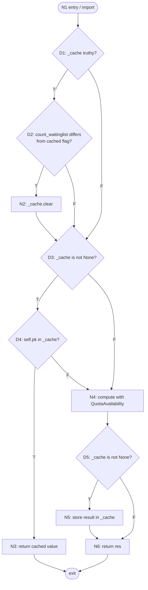

# Control Flow Graph and Cyclomatic Complexity (hand calculation)

**Function:** `Quota.availability()` in `src/pretix/base/models/items.py:2155-2188`
**Why this function:** it reads the **shared record** of our two workflows. W1 sets `Quota.size`; every W2 purchase asks `availability()` whether a seat is left. It also has short-circuit conditions and a cache, so its paths are not obvious from a quick read.

```python
def availability(self, now_dt=None, count_waitinglist=True, _cache=None, allow_cache=False):
    from ..services.quotas import QuotaAvailability                       # N1
    if _cache and count_waitinglist is not _cache.get('_count_waitinglist', True):   # D1, D2
        _cache.clear()                                                    # N2
    if _cache is not None and self.pk in _cache:                          # D3, D4
        return _cache[self.pk]                                            # N3
    qa = QuotaAvailability(count_waitinglist=count_waitinglist, early_out=False)    # N4
    qa.queue(self)
    qa.compute(now_dt=now_dt, allow_cache=allow_cache)
    res = qa.results[self]
    if _cache is not None:                                                # D5
        _cache[self.pk] = res                                             # N5
        _cache['_count_waitinglist'] = count_waitinglist
    return res                                                            # N6
```

Each condition of a short-circuit `and` is its own decision node, because Python evaluates the second operand only if the first is true. These are the paths that branch coverage at statement level hides.

## Control flow graph



**Nodes (N = 12):** N1, D1, D2, N2, D3, D4, N3, N4, D5, N5, N6, exit

**Edges (E = 16):**

| # | Edge | # | Edge | # | Edge | # | Edge |
| :-: | :--- | :-: | :--- | :-: | :--- | :-: | :--- |
| 1 | N1→D1 | 5 | D2→D3 (F) | 9 | D4→N3 (T) | 13 | D5→N5 (T) |
| 2 | D1→D2 (T) | 6 | N2→D3 | 10 | D4→N4 (F) | 14 | D5→N6 (F) |
| 3 | D1→D3 (F) | 7 | D3→D4 (T) | 11 | N3→exit | 15 | N5→N6 |
| 4 | D2→N2 (T) | 8 | D3→N4 (F) | 12 | N4→D5 | 16 | N6→exit |

## V(G) three ways

| Method | Calculation | V(G) |
| :--- | :--- | :-: |
| Edges and nodes | E − N + 2 = 16 − 12 + 2 | **6** |
| Decision nodes | P + 1 = 5 (D1..D5) + 1 | **6** |
| Regions | 5 bounded regions + 1 outer region of the planar graph | **6** |

All three methods agree, so **V(G) = 6**. At most 6 linearly independent paths exist, and 6 tests are an upper bound for basis-path testing.

**Comparison with SonarQube (measured 27 Nov 2026).** The function was copied unchanged into a file of its own and analysed
with SonarQube Community Build 25.1 (`sonar_function_complexity.py`, evidence `evidence/sonar_function_complexity.json`):
SonarQube reports **cyclomatic complexity 6** (and cognitive complexity 5). This equals the hand-calculated V(G) = 6,
because SonarQube's Python complexity counts the function entry plus every `if` **and every boolean operator**
(`and`/`or`): 1 + 3 `if` + 2 `and` = 6. (An earlier version of this document assumed SonarQube counts only `if`
statements and would report 4; the measurement shows that assumption was wrong.) Counting only the three `if`
statements would give 4 - that is the *statement-level* branch count, which is why condition-level coverage needs more
tests than branch coverage.

## Basis paths and feasibility

| Path | Decisions taken | Input that drives it | Feasible | Test |
| :-: | :--- | :--- | :-: | :--- |
| P1 | D1 F, D3 F, D5 F | `_cache=None` | ✅ | `test_p1_no_cache_computes_and_returns` |
| P2 | D1 F, D3 T, D4 F, D5 T | `_cache={}` (empty dict: falsy but not None) | ✅ | `test_p2_empty_cache_is_filled` |
| P3 | D1 T, D2 F, D3 T, D4 T | cache holds this quota, same waiting-list flag | ✅ | `test_p3_cached_value_is_returned_without_query` |
| P4 | D1 T, D2 T, clear, D3 T, D4 F, D5 T | cache built with the *other* waiting-list flag | ✅ | `test_p4_flag_change_clears_stale_cache` |
| P5 | D1 T, D2 F, D3 T, D4 F, D5 T | cache holds only another quota | ✅ | `test_p5_cache_without_this_quota_is_extended` |
| P6 | D1 T, …, D3 F | needs `_cache` truthy **and** `None` | ❌ infeasible | — |

**Why P6 is infeasible:** D1 true means `_cache` is a non-empty dict, so D3 (`_cache is not None`) can never be false on the same run. Of the edges, D3→N4 (F) is reachable only through D1 F, and D5→N6 (F) only when `_cache is None`. The basis therefore has **5 feasible paths**. The sixth independent path exists in the graph but not in any execution. This is a known limit of basis-path testing: V(G) is an upper bound, not always a count of runnable tests.

The 5 feasible paths together cover all 16 edges (100 % edge and branch coverage, including both outcomes of every short-circuit condition).

## Mapping to the workflows
- **P3** is the path a busy checkout takes when pretix evaluates many quotas in one request; a stale cache here would sell seats that no longer exist.
- **P4** is the guard against that: switching `count_waitinglist` must not reuse numbers computed under the other rule.
- **P1 / P2** are the plain W2 check before an order is created (`_check_positions` in `services/orders.py`).

## Viva: recomputing after a change
If, for example, `and not allow_cache` is added to the D3 line, that adds one decision node (D3b) and two edges, so V(G) = (16 + 2) − (12 + 1) + 2 = **7**, and the decision count is 6 + 1 = 7.
